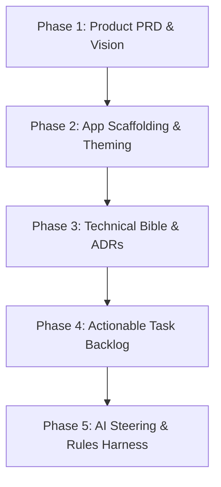

# Workspace Initialization Plan Suite — Master Index

**Suite ID:** `workspace-initialization`  
**Version:** `1.0.0`  
**Stage Contract:** [CONTEXT.md](./CONTEXT.md)  
**Machine Manifest:** [plan-manifest.json](./plan-manifest.json)

---

## 1. Overview & Execution Architecture

This plan suite governs the phased initialization and domain synthesis for **{{PROJECT_NAME}}**. Execution is strictly staged into 5 sequential phases with bounded context floors ($\le 4,500$ tokens per phase contract), zero static starter seeds, and deterministic verification gates.

---

## 2. Phase Execution Ledger

| Phase | Phase Contract | Units | Dependencies | Primary Verification |
|---|---|---|---|---|
| **Phase 1** | [phase-1-product-prd-and-vision.md](./phase-1-product-prd-and-vision.md) | `U1`, `U2` | None | PRD & Vision synthesis depth validation |
| **Phase 2** | [phase-2-app-scaffolding-and-theming.md](./phase-2-app-scaffolding-and-theming.md) | `U3`, `U4`, `U5`, `U6` | `P1` | Application stylesheet sync & SQL migration check |
| **Phase 3** | [phase-3-technical-bible-and-adrs.md](./phase-3-technical-bible-and-adrs.md) | `U7`, `U8` | `P2` | Modular Bible structure & ADR ledger validation |
| **Phase 4** | [phase-4-actionable-task-backlog.md](./phase-4-actionable-task-backlog.md) | `U9`, `U10` | `P3` | User-story task card validation ($\le 12$ tasks) |
| **Phase 5** | [phase-5-ai-steering-and-harness.md](./phase-5-ai-steering-and-harness.md) | `U11`, `U12` | `P4` | Context budget validation (AGENTS.md $\le 60$ lines) |

---

## 3. Locked Decisions & Invariants

1. **LOCK-INIT3-12 (Mechanical Scaffolding Isolation):** Scaffolding executes in `apps/web/` without polluting workspace root.
2. **LOCK-INIT3-15 (Application Stylesheet Synchronization):** Injects active OKLCH tokens into `globals.css` immediately after cloning.
3. **LOCK-INIT3-16 (Environment & Research Binding):** All external SDKs and environment keys derive from research dossiers.
4. **LOCK-INIT3-18 (Tier 2 Multi-Phase Plan):** Monolithic plan-less execution is forbidden.
