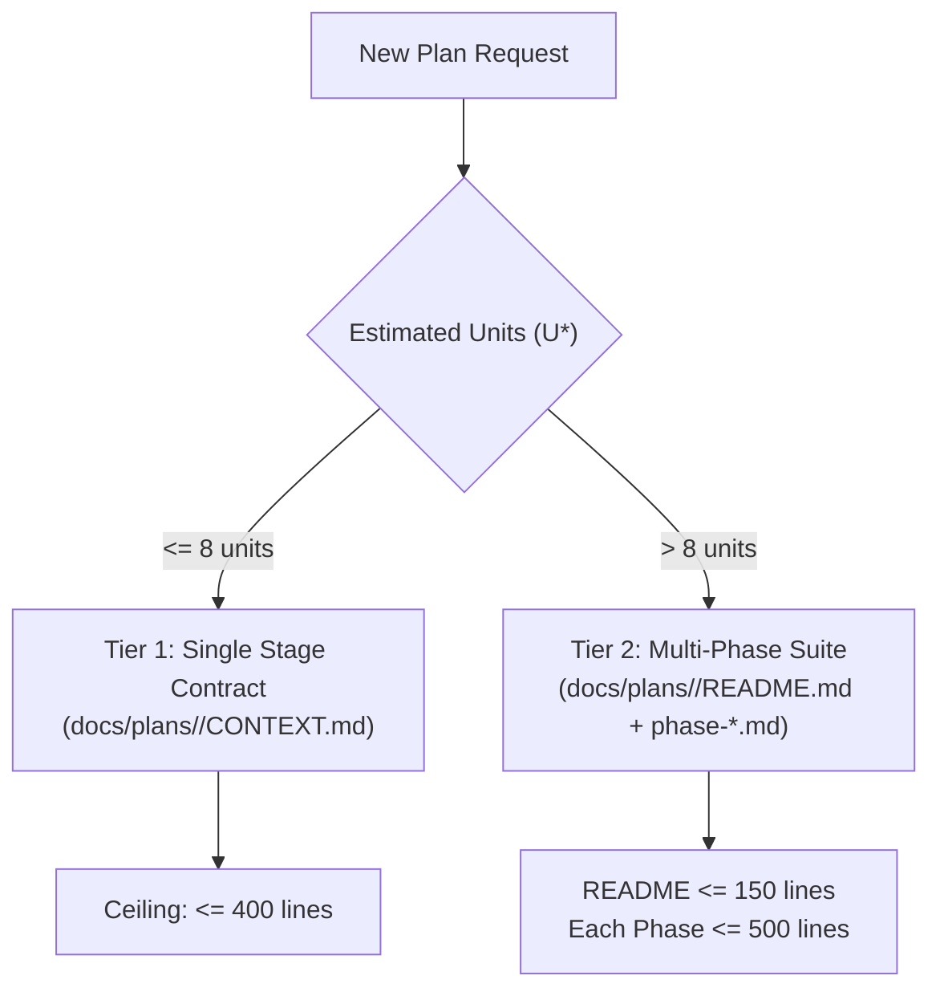

# Phase Decomposition Guide: Tier 1 vs. Tier 2 Architectures

This guide defines how to size, slice, and structure implementation plans in the ShiftStone AI-Native Workspace Framework.

---

## 1. Overview & Triage Heuristic

Every feature, refactor, or upgrade must be classified into either Tier 1 or Tier 2 before drafting begins:

---

## 2. Tier 1: Single Stage Plan (`docs/plans/<plan-id>/CONTEXT.md`)

Use Tier 1 when:
- The task requires $\le 8$ discrete Plan Units.
- The work touches a single subsystem or tightly coupled set of files.
- The total execution time is expected to take 1–3 agent iterations.

### Structure:
- Stored directly in `docs/plans/<plan-id>/CONTEXT.md`.
- Opens with `stage-contract/v1` YAML frontmatter.
- Contains the 5 standard markdown sections:
  1. `## Human Effort` (Band: DIRECTION | AUTOMATED | ALIGNMENT)
  2. `## Inputs` (Declared files with roles)
  3. `## Process` (Numbered procedural steps)
  4. `## Outputs` (Target deliverables)
  5. `## Plan Units` (Embedded `U1`–`U8` definitions)
- Maximum file size: **400 lines**.

---

## 3. Tier 2: Multi-Phase Suite (`docs/plans/<suite-name>/`)

Use Tier 2 when:
- The task requires $> 8$ discrete Plan Units.
- The work spans multiple subsystems, architectural layers (`core` + `pack`), or releases.
- Execution is staged over multiple sessions or involves specialized maker/checker iterations.

### Structure:
1. **Suite Index (`docs/plans/<suite-name>/README.md`):**
   - Maximum file size: **150 lines**.
   - Contains executive summary, locked architectural decisions table, and Phase Index table.
   - Includes Mermaid dependency graph between phases.
   - Summarizes cumulative verification commands.
2. **Phase Execution Files (`docs/plans/<suite-name>/phase-<N>-<slug>.md`):**
   - Maximum file size: **500 lines per file**.
   - Contains:
     - Frontmatter with `type: plan`, `status: planned | in-progress | completed`, and dependency pointers.
     - Section 1: Objective & Scope.
     - Section 2: Plan Units (`plan-unit/v1` format).
     - Section 3: Task Summary Table (`ID | Unit | Task | Target Files | Verification | Depends On`).
     - Section 4: Phase Exit Criteria checklist.
     - Section 5: Traceability & Research citations.

---

## 4. Plan Unit Sizing Rules

1. **Atomicity:** Each unit `U*` must represent a single, cohesive change that can be independently verified by running its `verificationCommand`.
2. **File Target Ceiling:** A single unit should rarely target more than 5–7 files. If more are needed, split into multiple units.
3. **Traceability:** Never introduce an acceptance criterion without mapping it to a declared requirement ID (`UG-*` or `REQ-*`).
