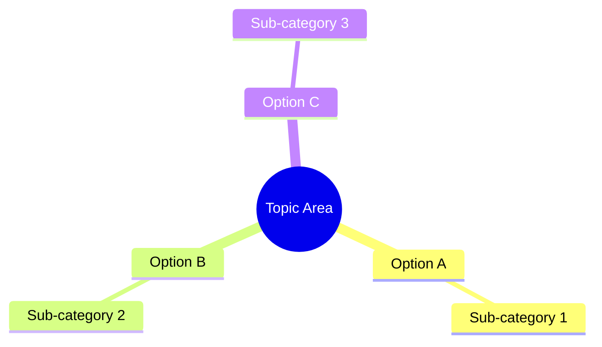

# [Topic] — Research Summary

---

## 📌 Executive Summary

*Write a 2-3 sentence overview of what was researched, the key findings, and the final recommendation. This should be readable by anyone on the team.*

---

## 🗺️ Landscape Overview

*Describe the overall landscape of options in plain language. Define jargon inline, using parentheses on first use. For example: "SaaS (Software as a Service — software that is hosted in the cloud and licensed on a subscription basis)"*.

### Topic Mindmap

---

## 🟢 Recommended Solution: [Selected Option]

*Provide a plain-language explanation of why this option was chosen and how it benefits the project. Outline any trade-offs in simple terms.*

---

## 🛠️ Action Plan

1. **Step 1**: [Action description]
2. **Step 2**: [Action description]
3. **Step 3**: [Action description]
