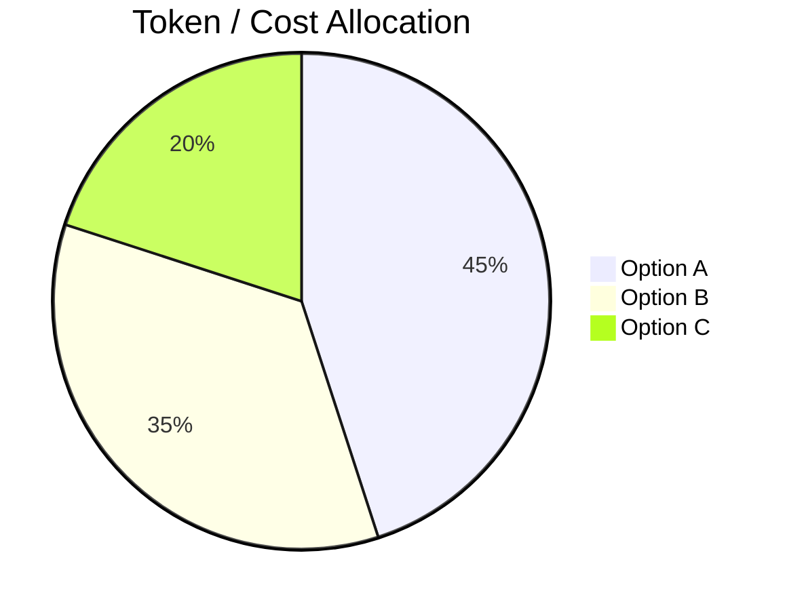

# [Topic] — Technical Findings

---

## 📊 Overview of Evaluated Options

*Provide a deep-dive evaluation of each candidate option, outlining pricing structures, limits, performance characteristics, and integration details.*

### Option A
- **Pricing**: [Detailed pricing tiers, free limits]
- **Architecture**: [How it connects, serverless compatibility, cold starts]
- **Pros**:
  - Pro 1
  - Pro 2
- **Cons**:
  - Con 1
  - Con 2

### Option B
- **Pricing**: [Detailed pricing tiers]
- **Architecture**: [Connection models, protocols]
- **Pros**:
  - Pro 1
- **Cons**:
  - Con 1

---

## ⚙️ Next.js + Supabase Compatibility

*Analyze how each option fits into our technical stack, including:*
- Edge Runtime support (Vercel)
- Supabase Auth session sharing
- Database connection pool impact (stateless client connections vs pools)
- TypeScript strict compiler compatibility

### Telemetry / Resource Allocation

