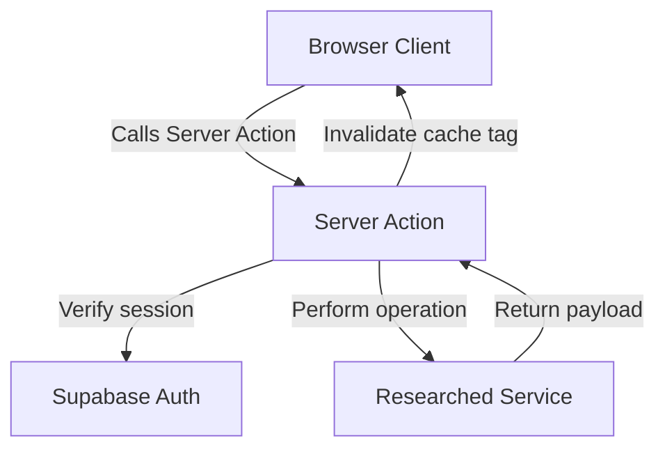
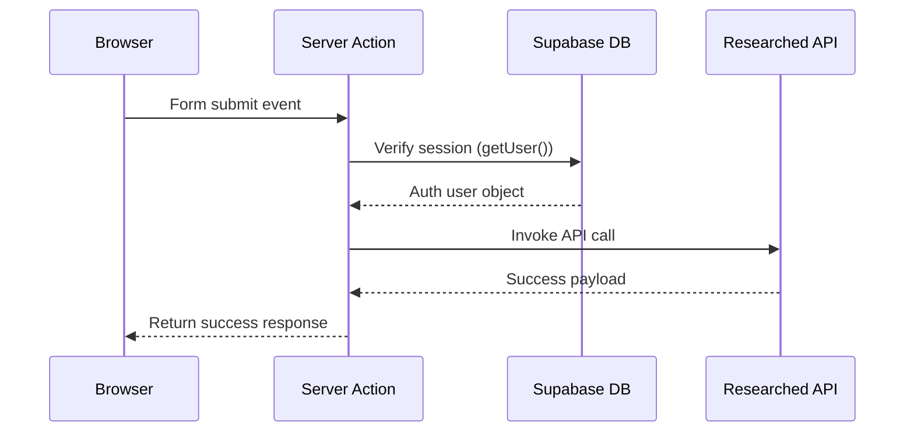

# [Topic] — Implementation Guide

---

## 🛠️ Code Setup

*Provide the exact code patterns required to integrate this solution into the Next.js + Supabase monorepo structure.*

### 1. Package Installation
```bash
{{PACKAGE_MANAGER}} --filter @{{PROJECT_NAME_LOWER}}/auth add [dependency]
```

### 2. Client Adapter Configuration
```typescript
// packages/[module]/src/client.ts
import { createServerClient } from '@{{PROJECT_NAME_LOWER}}/auth/server'

export async function getClient() {
  const supabase = await createServerClient()
  // client setup details
}
```

---

## 🗺️ Integration Flowchart



---

## 🔄 Sequence Diagram


